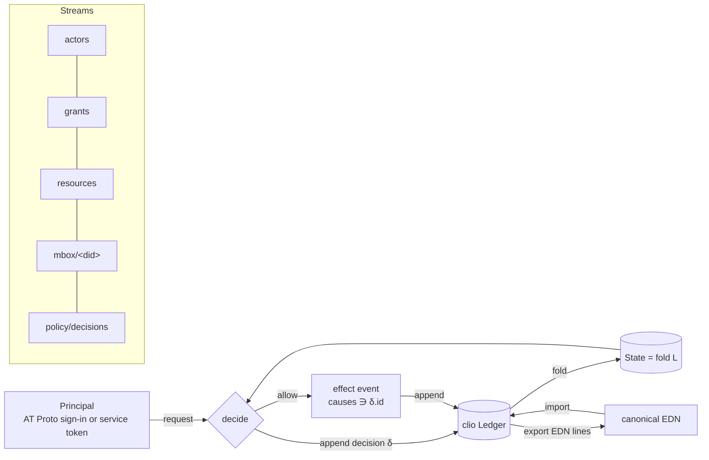

# Axxium access kernel: math model

Status: model for riatzukiza/axxium PRs "actor kinds", "mailboxes",
"resource registry" and "Google Drive resource". Shapes follow Katamorph
(riatzukiza/katamorph #7 Resource, #4 Grant/Revoke, #6 Message/Mailbox,
#5 resource-plus-action policy). Events follow clio (open-hax/clio 9b14cda).

## Objects

| Object | Carrier |
|---|---|
| `Did` | `did:plc:<24 base32>` for PDS accounts, `did:web:<host>` for the Axxium service |
| `Actor` | `{:actor/did Did :actor/kind K :actor/name s}`, `K ∈ {:human :agent :process :group :team :org}` |
| `Collective` | actors with `K ∈ {:group :team :org}` |
| `Resource` | Katamorph Resource `{:resource/id :resource/kind :resource/owner Did :resource/store\|:resource/location :resource/metadata}` |
| `Action` | keyword, e.g. `:member :send :read :put :get :list :register` |
| `Grant` / `Revoke` | Katamorph Grant / Revoke |
| `Event` | clio event `{:event/id :event/stream :event/seq :event/causes :event/type :event/actor :event/at :event/body}` |
| `Ledger` | `L = [e₁ … eₙ]`, a finite sequence of events |
| `Decision` | event of type `:axxium.policy/decided` with body `{:decision/request q :decision/allow? b :decision/reason r}` |

## Morphisms

- `append : Ledger × Event → Ledger + Error`
- `fold : Ledger → State` (projection; `State` holds actors, grants, resources, mailboxes)
- `allowed? : State × Did × ResourceId × Action × Inst → Bool`
- `decide : State × Request → Decision`
- `act : Ledger × Request × Effect → Ledger` (append the decision, then the effect only if allowed)
- `export : Ledger → EDN-lines`, `import : EDN-lines → Ledger`
- `mbox : Did → Stream`, `mbox(d) = "mbox/" ++ d`

## Laws

1. **Stream order.** For every stream `s`, the seqs of `L|s` are `1, 2, …, |L|s|` in append order.
2. **Identity.** Event ids are unique; causes are earlier event ids and never the event itself.
3. **Projection.** `fold` is a left fold: `fold(L ++ [e]) = step(fold(L), e)`; state is never mutated in place.
4. **Membership is a grant.** `d ∈ members(c)` iff an unrevoked, unexpired grant gives `d` the action `:member` on resource `actor:c`.
5. **Inherited authority.** `allowed?(d, r, a, t)` iff a live grant gives `a` on `r` to `d` or to some collective `c` with `d ∈⁺ members(c)` (transitive, cycle safe).
6. **Revocation is monotone.** Appending a revoke never adds authority: `allowed?` after ⊆ before.
7. **Decision before effect.** For every effect event `e` produced by `act` there is a decision `δ` with `δ` earlier in `L`, `δ.allow? = true` and `δ.id ∈ e.causes`. A denied request appends only `δ`.
8. **Authenticated senders.** A message in `mbox(d)` has `event/actor = principal.did` where the principal was verified by AT Protocol sign-in or a signed Axxium service token.
9. **No overwrite, no delete (Drive).** `put` on an existing name in the target folder is refused; there is no delete morphism.
10. **Round trip.** `import(export(L)) = L` and `canonical-edn` (clio) of every event is unchanged by the trip.

