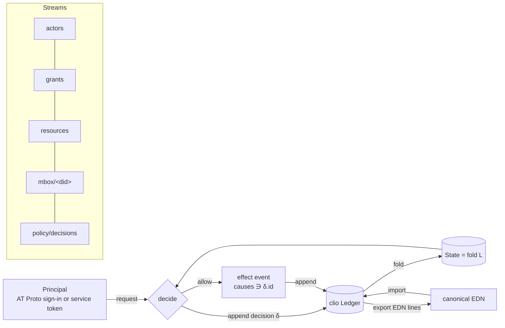
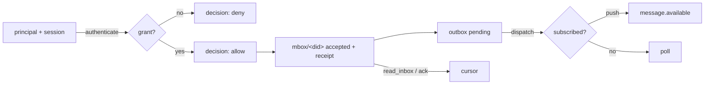

# Axxium access kernel: math model

Status: model for riatzukiza/axxium PRs "actor kinds", "mailboxes",
"resource registry" and "Google Drive resource". Shapes follow Katamorph
(riatzukiza/katamorph #7 Resource, #4 Grant/Revoke, #6 Message/Mailbox,
#5 resource-plus-action policy). Events follow clio (open-hax/clio 9b14cda).

## Objects

| Object | Carrier |
|---|---|
| `Did` | `did:plc:<24 base32>` for PDS accounts, `did:web:<host>` for the Axxium service |
| `Actor` | `{:actor/did Did :actor/kind K :actor/name s}`, `K ∈ {:human :agent :process :group :team :org}` |
| `Collective` | actors with `K ∈ {:group :team :org}` |
| `Resource` | Katamorph Resource `{:resource/id :resource/kind :resource/owner Did :resource/store\|:resource/location :resource/metadata}` |
| `Action` | keyword, e.g. `:member :send :read :put :get :list :register` |
| `Grant` / `Revoke` | Katamorph Grant / Revoke |
| `Event` | clio event `{:event/id :event/stream :event/seq :event/causes :event/type :event/actor :event/at :event/body}` |
| `Ledger` | `L = [e₁ … eₙ]`, a finite sequence of events |
| `Decision` | event of type `:axxium.policy/decided` with body `{:decision/request q :decision/allow? b :decision/reason r}` |

## Morphisms

- `append : Ledger × Event → Ledger + Error`
- `fold : Ledger → State` (projection; `State` holds actors, grants, resources, mailboxes)
- `allowed? : State × Did × ResourceId × Action × Inst → Bool`
- `decide : State × Request → Decision`
- `act : Ledger × Request × Effect → Ledger` (append the decision, then the effect only if allowed)
- `export : Ledger → EDN-lines`, `import : EDN-lines → Ledger`
- `mbox : Did → Stream`, `mbox(d) = "mbox/" ++ d`

## Laws

1. **Stream order.** For every stream `s`, the seqs of `L|s` are `1, 2, …, |L|s|` in append order.
2. **Identity.** Event ids are unique; causes are earlier event ids and never the event itself.
3. **Projection.** `fold` is a left fold: `fold(L ++ [e]) = step(fold(L), e)`; state is never mutated in place.
4. **Membership is a grant.** `d ∈ members(c)` iff an unrevoked, unexpired grant gives `d` the action `:member` on resource `actor:c`.
5. **Inherited authority.** `allowed?(d, r, a, t)` iff a live grant gives `a` on `r` to `d` or to some collective `c` with `d ∈⁺ members(c)` (transitive, cycle safe).
6. **Revocation is monotone.** Appending a revoke never adds authority: `allowed?` after ⊆ before.
7. **Decision before effect.** For every effect event `e` produced by `act` there is a decision `δ` with `δ` earlier in `L`, `δ.allow? = true` and `δ.id ∈ e.causes`. A denied request appends only `δ`.
8. **Authenticated senders.** A message in `mbox(d)` has `event/actor = principal.did` where the principal was verified by AT Protocol sign-in or a signed Axxium service token.
9. **No overwrite, no delete (Drive).** `put` on an existing name in the target folder is refused; there is no delete morphism.
10. **Round trip.** `import(export(L)) = L` and `canonical-edn` (clio) of every event is unchanged by the trip.

## Mailboxes (PR 3)

- `send : Ledger × State × Principal × Did × Body → Ledger` is `act` with
  request `(principal.did, mbox(to), :send)` and effect `:axxium.mbox/sent` on
  `mbox(to)`. Rule: the owner of `mbox(d)` (actor `d`) may always act on it;
  everyone else needs a live `:send` grant, directly or through a collective.
- `read : Ledger × State × Principal → Ledger × [Event]` records a `:read`
  decision and returns `L|mbox(principal.did)` only when allowed.
- Principals come only from `law.principal`: `:atproto` (OAuth session DID) or
  `:service-token` (Ed25519 instance-signed token with a `did` claim).
  Wiring these into HTTP routes is a follow-up; the kernel refuses anything else.

## Resource registry (PR 4)

- `register : (actor, Resource) → Ledger` is `act` with `(actor, "registry", :register)`;
  rule: an actor may register a resource it owns. Effect `:axxium.resource/registered` on `resources`.
- `issue-grant`, `issue-revoke` are `act` with `(granter, resource, :grant)`; rule: the owner may grant.
- `move : (actor, resource, store, location)` is `act` with `(actor, resource, :move)`;
  effect `:axxium.resource/moved`. Moving to Drive or back is this morphism.
- Local kinds: `:resource/file` (`file:<path>`), `:resource/process` (`process:<pid>`), `:resource/program` (`program:<path>`).
- Registry state = `fold` of `resources` events; metadata only, never file contents.

## PR 5 — Addressable mailbox MCP (contract: docs/addressable-mailbox-mcp-mvp.md)

Objects: Session `(id, did, method, aud, expires, push?)`, Message `(id, from, to, body, key, owner, receipt)`, OutboxEntry `(message-id, recipient)`, Dispatch `(message-id, channel ∈ {push, poll})`, Ack `(message-id, seq)`.

Morphisms (all `Ledger × Ctx × Args → Ledger × (Result + Error)`): open_session, register_mailbox, grant_send, revoke_send, send_message, read_inbox, acknowledge_message, get_delivery, whoami, resolve_address; and `dispatch : Ledger × Instant → Ledger × [Notification]`.

Laws:
- M1 (fail closed): no principal, unknown session, session/principal mismatch, wrong audience, expired session, forged `from`, or missing/revoked grant ⇒ Error, and the ledger gains at most a refusal decision.
- M2 (idempotence): `send(k, b)` twice ⇒ same message and receipt, one event; `send(k, b')` with b' ≠ b ⇒ `:idempotency-conflict`.
- M3 (atomic batch): decision, message+receipt, and outbox entry are one ledger transition; persistence writes that batch in one fsynced write.
- M4 (exactly-once dispatch): `dispatch ∘ dispatch = dispatch` on pending entries; replay after a crash neither loses nor duplicates.
- M5 (cursor): `read_inbox` defaults to the last acknowledged seq, so a reconnecting worker resumes there.
- M6 (no false claims): notification ⇏ execution (`:delivery/execution :unknown`); push only to sessions that declared push; others are `:poll`.
- M7 (no secrets): bodies with credential-like keys or values are refused; notifications carry no payload.

Not covered here: acceptance test 8's "real ChatGPT client" half and test 7 against a deployed endpoint need the staging environment that open-hax/services owns. The in-process JSON-RPC test covers discovery, send and receipt; the HTTP transport mount is a follow-up.
